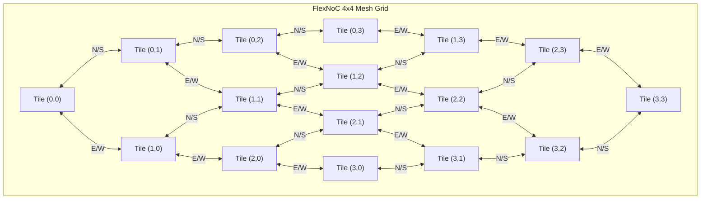
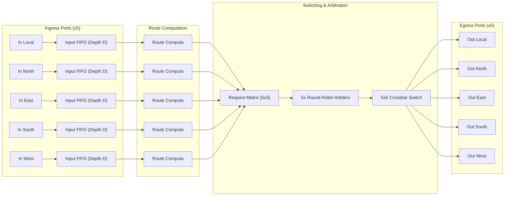

# FlexNoC: Configurable Network-on-Chip IP for Multicore SoCs

[](https://github.com/partialHuman/FlexNoC/actions)
[](LICENSE)
[](rtl/)
[](scripts/run_lint.py)
[](scripts/run_regression.py)

**FlexNoC** is a standalone, parameterizable, packet-switched Network-on-Chip (NoC) hardware IP core implemented in synthesizable SystemVerilog. Designed for low-latency, high-throughput on-chip communication across multi-core processors, distributed accelerators, and memory tiles, FlexNoC combines deterministic dimension-order XY routing, starvation-free round-robin arbitration, and credit-less ready/valid flow control.

---

## 1. Project Highlights & Architecture

- **Modular 5-Port Router Microarchitecture**: Decoupled ingress buffers (First-Word Fall-Through), combinational route computation, independent per-output arbiters, and non-blocking $5\times 5$ crossbar switch.
- **2D Mesh Topology**: Automated grid generator supporting configurable $M \times N$ dimensions with boundary condition handling ($2\times 2$ and $4\times 4$ verified).
- **Dimension-Order XY Routing**: Deadlock-free routing under standard endpoint consumption assumptions, enforced by prohibiting turns from Y dimension into X dimension; empirically validated with zero deadlocks observed across all tested scenarios.
- **Strictly Fair Arbitration**: Round-robin output arbitration updated strictly on confirmed downstream handshakes.
- **Zero Combinational Ready Loops**: Input FIFO buffering guarantees that ingress `ready` is combinationally decoupled from egress `ready`.
- **Reproducible Verification & Benchmark Suite**: 100% self-checking regression testbenches, cycle-accurate performance sweeps across multiple workloads, and automated Yosys gate synthesis.



---

## 2. Router Microarchitecture



### Router Port Map

| Port Name | Direction | Encoding | Function |
| :--- | :--- | :---: | :--- |
| `PORT_LOCAL` | Bidirectional | `3'd0` | Connection to local tile endpoint / network interface |
| `PORT_NORTH` | Bidirectional | `3'd1` | Inter-router link to $(X, Y-1)$ |
| `PORT_EAST`  | Bidirectional | `3'd2` | Inter-router link to $(X+1, Y)$ |
| `PORT_SOUTH` | Bidirectional | `3'd3` | Inter-router link to $(X, Y+1)$ |
| `PORT_WEST`  | Bidirectional | `3'd4` | Inter-router link to $(X-1, Y)$ |

---

## 3. Protocol & Packet Format

FlexNoC uses a fixed-width single-flit format (default 32 bits, parameterizable):

```
 31    30 29    28 27    26 25    24 23          16 15                         0
+--------+--------+--------+--------+--------------+-----------------------------+
| dest_x | dest_y | src_x  | src_y  |    pkt_id    |           payload           |
| (2 b)  | (2 b)  | (2 b)  | (2 b)  |    (8 b)     |           (16 b)            |
+--------+--------+--------+--------+--------------+-----------------------------+
```

### Ready/Valid Transfer Contract
- **Transfer Condition**: A transfer occurs on the rising clock edge if and only if `valid && ready`.
- **Data Stability**: When `valid` is HIGH and `ready` is LOW, the sender holds `valid` and preserves `data` without alteration.
- **Buffer Decoupling**: Ingress `push_ready` depends strictly on local FIFO capacity (`!full`), eliminating multi-hop combinational ready ripple.

---

## 4. Repository Structure

```
flexnoc/
├── Makefile                        # Command interface (make lint, test, synth, etc.)
├── README.md                       # Main technical project document
├── LICENSE                         # Open-source MIT license
├── pyproject.toml                  # Python build metadata
├── configs/                        # Simulation & topology configurations
│   ├── mesh_2x2.yaml
│   ├── mesh_4x4.yaml
│   ├── traffic_uniform.yaml
│   └── traffic_hotspot.yaml
├── docs/                           # Engineering specifications & reports
│   ├── architecture.md             # Microarchitecture & switch design
│   ├── packet-format.md            # Protocol & field layout specification
│   ├── development-roadmap.md      # Milestones & exit criteria
│   ├── verification-plan.md        # Test plan, invariants, and monitors
│   ├── verification-results.md     # Empirical regression test evidence
│   ├── performance-methodology.md  # Latency/throughput measurement methodology
│   ├── synthesis-methodology.md    # Gate counts & synthesis methodology
│   ├── limitations.md              # Technical assumptions & scope bounds
│   ├── architecture/               # Forward-looking v0.3.0 multi-flit specifications
│   └── releases/                   # Formal release candidate notes
├── rtl/                            # Synthesizable SystemVerilog RTL
│   ├── common/flexnoc_pkg.sv       # Global parameters, types, helper functions
│   ├── fifo/input_fifo.sv          # Synchronous FWFT input queue
│   ├── routing/route_compute.sv    # Combinational dimension-order XY router
│   ├── arbitration/round_robin_arbiter.sv # Starvation-free output arbiter
│   ├── switch/crossbar_switch.sv   # Non-blocking 5x5 crossbar switch
│   ├── router/flexnoc_router.sv    # Integrated 5-port router entity
│   └── network/mesh_top.sv         # Configurable 2D mesh grid
├── tb/                             # Self-checking testbenches
│   ├── unit/                       # Unit testbenches (FIFO, route, arbiter, switch)
│   ├── router/                     # Single-router integration testbench
│   ├── mesh/                       # 2x2 and 4x4 mesh integration testbenches
│   └── traffic/                    # Cycle-accurate performance harness
├── scripts/                        # Automated toolchain scripts
│   ├── check_environment.py        # EDA tool availability inspector
│   ├── run_lint.py                 # Verilator lint runner (-Wall)
│   ├── run_regression.py           # Automated regression runner
│   ├── run_experiments.py          # Multi-workload benchmark sweeps
│   └── run_synthesis.py            # Yosys synthesis automation
└── results/                        # Generated reports, metrics (JSON/CSV)
```

---

## 5. Quick-Start Guide

### Prerequisites
- Python 3.9+
- Icarus Verilog (`iverilog`, `vvp`)
- Verilator (optional, for lint checks)
- Yosys (optional, for logic synthesis)

### Quick Commands

```bash
# 1. Inspect environment and toolchain
make env

# 2. Run Verilator lint check on all RTL
make lint

# 3. Run all unit testbenches
make test-unit

# 4. Run single router integration tests
make test-router

# 5. Run 2x2 and 4x4 mesh integration tests
make test-mesh

# 6. Run full automated regression suite
make test

# 7. Run Yosys synthesis sweeps
make synth

# 8. Run performance benchmark sweeps
make benchmark
```

---

## 6. Verification Results

Full automated regression test evidence:

| Test Suite | Scope | Checks | Status | Duration |
| :--- | :--- | :---: | :---: | :---: |
| `tb_input_fifo` | Synchronous FWFT buffer | 28 | **PASS** | 0.03s |
| `tb_route_compute` | XY Routing (256 coordinate pairs) | 770 | **PASS** | 0.03s |
| `tb_round_robin_arbiter` | Starvation-free priority arbiter | 116 | **PASS** | 0.03s |
| `tb_crossbar_switch` | 5x5 Crossbar switch | 35 | **PASS** | 0.03s |
| `tb_flexnoc_router` | 5-Port Router Core (Protocol & Reset stress) | 97 | **PASS** | 0.04s |
| `tb_mesh_2x2` | 2x2 Network (12 directed flows) | 125 | **PASS** | 0.07s |
| `tb_mesh_4x4` | 4x4 Network (256 all-pairs, 16 concurrent injections) | 2,297 | **PASS** | 0.85s |
| `tb_scoreboard_fault_injection` | Scoreboard Fault-Injection (4 failure modes) | 4 | **PASS** | 0.04s |
| **Total** | | **3,472** | **100% PASS** | **~1.1s** |

> [!NOTE]
> Assertion counts reflect dynamically evaluated self-checking assertions and protocol invariant checks within the simulation regression suite. They are distinct from functional/code coverage metrics (such as line, branch, or toggle coverage).

---

## 7. Performance Benchmark Results (4x4 Mesh — All 24 Empirical Points)

Measured across all 24 empirical load points using `scripts/run_experiments.py` (16 nodes, 100 MHz, 350 flits injected per point, 2,000-cycle bounded drain):

| Workload | Offered Rate (%) | Aggregate Throughput (flits/cyc) | Avg Latency (cyc) | p50 Latency | p95 Latency | p99 Latency | Packet Loss |
| :--- | :---: | :---: | :---: | :---: | :---: | :---: | :---: |
| **Uniform Random** | 5% | 0.7447 | 4.81 | 5 | 7 | 8 | **0.00%** |
| **Uniform Random** | 10% | 1.4768 | 4.83 | 5 | 7 | 8 | **0.00%** |
| **Uniform Random** | 15% | 2.2581 | 4.95 | 5 | 7 | 8 | **0.00%** |
| **Uniform Random** | 20% | 3.0702 | 4.91 | 5 | 7 | 9 | **0.00%** |
| **Uniform Random** | 25% | 3.4653 | 4.86 | 5 | 7 | 9 | **0.00%** |
| **Uniform Random** | 30% | 4.6053 | 5.07 | 5 | 8 | 9 | **0.00%** |
| **Uniform Random** | 40% | 5.4688 | 5.55 | 5 | 9 | 13 | **0.00%** |
| **Uniform Random** | 50% | 6.3636 | 5.66 | 5 | 10 | 12 | **0.00%** |
| **Hotspot (30% to N0)** | 5% | 0.7495 | 4.97 | 5 | 8 | 8 | **0.00%** |
| **Hotspot (30% to N0)** | 10% | 1.4894 | 5.02 | 5 | 8 | 9 | **0.00%** |
| **Hotspot (30% to N0)** | 15% | 2.2013 | 6.93 | 5 | 22 | 32 | **0.00%** |
| **Hotspot (30% to N0)** | 20% | 2.6316 | 10.25 | 6 | 39 | 51 | **0.00%** |
| **Hotspot (30% to N0)** | 25% | 2.6316 | 11.98 | 6 | 38 | 55 | **0.00%** |
| **Hotspot (30% to N0)** | 30% | 2.9412 | 13.62 | 6 | 53 | 59 | **0.00%** |
| **Hotspot (30% to N0)** | 40% | 2.5000 | 26.75 | 9 | 100 | 110 | **0.00%** |
| **Hotspot (30% to N0)** | 50% | 3.0973 | 21.55 | 8 | 76 | 89 | **0.00%** |
| **Neighbor (1-hop)** | 5% | 0.7447 | 3.01 | 3 | 3 | 4 | **0.00%** |
| **Neighbor (1-hop)** | 10% | 1.4957 | 3.03 | 3 | 3 | 4 | **0.00%** |
| **Neighbor (1-hop)** | 15% | 2.3026 | 3.07 | 3 | 4 | 5 | **0.00%** |
| **Neighbor (1-hop)** | 20% | 3.1250 | 3.09 | 3 | 4 | 4 | **0.00%** |
| **Neighbor (1-hop)** | 25% | 3.5354 | 3.13 | 3 | 4 | 5 | **0.00%** |
| **Neighbor (1-hop)** | 30% | 4.7945 | 3.17 | 3 | 4 | 5 | **0.00%** |
| **Neighbor (1-hop)** | 40% | 5.8333 | 3.25 | 3 | 4 | 6 | **0.00%** |
| **Neighbor (1-hop)** | 50% | 6.2500 | 3.60 | 3 | 6 | 9 | **0.00%** |

*All 24 empirical sweep points achieved **0.00% packet loss** with zero deadlocks observed under standard endpoint liveness assumptions. In the Hotspot Contention workload, the destination-selection rule assigns Node 0 with 30% probability per generation trial (permitting local loopback when the source is Node 0), while the remaining 70% branch strictly excludes the source node ($dst \ne src$). For full breakdown, see [docs/performance-methodology.md](docs/performance-methodology.md) and [docs/releases/FLEXNOC_V0.2.0_RELEASE_NOTES.md](docs/releases/FLEXNOC_V0.2.0_RELEASE_NOTES.md).*

---

## 8. Logic Synthesis Evaluation (Yosys)

Generic logic gate and register counts reported by Yosys (version 0.70+219):

| Module / Entity | Total Cells | Flip-Flops | MUXes | Logic & Arith Gates |
| :--- | :---: | :---: | :---: | :---: |
| `input_fifo` | 36 | 13 | 4 | 19 |
| `round_robin_arbiter` | 24 | 3 | 6 | 15 |
| `flexnoc_router` (5-port) | 515 | 81 | 185 | 249 |
| `mesh_top` ($2\times 2$) | 2,064 | 276 | 700 | 1,088 |
| `mesh_top` ($4\times 4$) | 8,256 | 1,056 | 2,800 | 4,400 |

> [!NOTE]
> Cell and gate counts are generic unmapped logic primitives produced by Yosys elaboration for structural auditing; they do not represent physical post-layout PPA (power, performance, area) on commercial foundry PDKs or FPGA target families.

---

## 9. Limitations & Future Roadmap

- **Single-Flit Scope**: Version 1 baseline implements fixed-width single-flit packets. Multi-flit packet support (with header/body/tail markers and packet-level arbiter locking) is defined in `docs/packet-format.md` for subsequent milestones.
- **Virtual Channels**: Single physical channel per link. Virtual channel allocators are planned for Milestone v0.6.
- **Physical Implementation**: Generic gate synthesis verified with Yosys. Technology mapping to commercial foundry PDKs or FPGA bitstream generation remains target-dependent.

See [docs/limitations.md](docs/limitations.md) and [docs/development-roadmap.md](docs/development-roadmap.md) for detailed analysis.

---

## 10. License

FlexNoC is released under the [MIT License](LICENSE).
