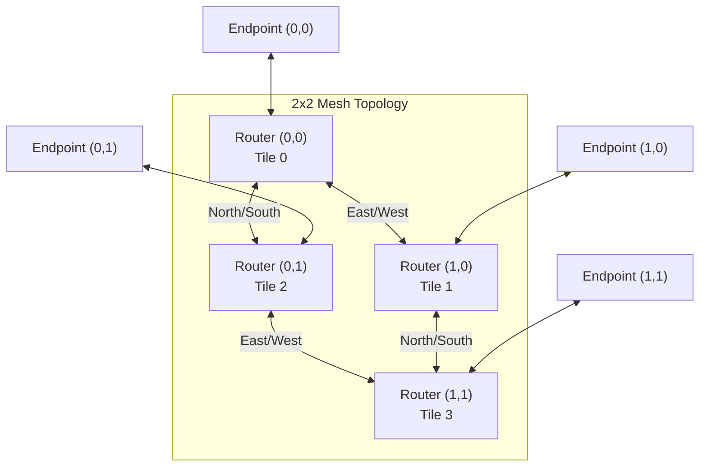
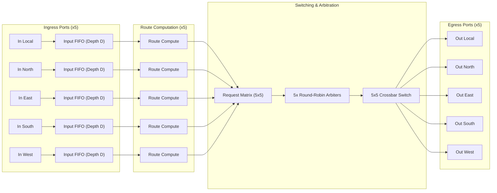

# FlexNoC Architecture Specification

## 1. Executive Summary

FlexNoC is a modular, parameterizable, packet-switched Network-on-Chip (NoC) hardware IP designed in synthesizable SystemVerilog. The architecture is optimized for low-latency, high-throughput on-chip communication across multi-core processors, accelerators, and distributed memory tiles in modern SoCs.

FlexNoC utilizes a **2D Mesh topology**, **deterministic dimension-order XY routing**, **round-robin per-output arbitration**, and **synchronous ready/valid credit-less flow control**.

---

## 2. High-Level Network Topology

FlexNoC connects network nodes in a regular 2D grid. Each tile comprises a router and a local processing element (PE) or network interface (NI):



### Coordinate & Addressing Conventions
- Routers are addressed as $(X, Y)$ where $X \in [0, \text{MESH\_WIDTH}-1]$ and $Y \in [0, \text{MESH\_HEIGHT}-1]$.
- Origin $(0, 0)$ is situated at the top-left (North-West) corner.
- Coordinate width is dynamically derived as $W_X = \lceil\log_2(\text{MESH\_WIDTH})\rceil$ and $W_Y = \lceil\log_2(\text{MESH\_HEIGHT})\rceil$.

---

## 3. Router Microarchitecture

Each FlexNoC router consists of five bidirectional ports: **Local**, **North**, **East**, **South**, and **West**.

The router employs an **Input-Queued (IQ)** architecture with independent per-output round-robin arbiters and a non-blocking $5 \times 5$ crossbar switch.



### Microarchitectural Components

1. **Input Buffers (`input_fifo`)**:
   - Each ingress port is equipped with a synchronous FIFO of parameterizable depth `FIFO_DEPTH` (default 4 flits).
   - The buffer isolates link delays and downstream backpressure.
   - Provides registered or direct `empty`, `full`, and occupancy status.
   - The link `in_ready` signal is driven directly by `!fifo_full`, ensuring **zero combinational path** from egress `out_ready` to ingress `in_ready`.
2. **Route Computation (`route_compute`)**:
   - Pure combinational logic evaluating the destination $(X_{\text{dest}}, Y_{\text{dest}})$ from the flit at the FIFO head against the router's assigned $(X_{\text{curr}}, Y_{\text{curr}})$.
   - Outputs a 1-hot target port vector `req[4:0]`.
3. **Round-Robin Output Arbiters (`round_robin_arbiter`)**:
   - One arbiter per egress port (5 arbiters total).
   - Evaluates requests from all 5 ingress FIFOs destined for this output.
   - Enforces fair, starvation-free scheduling among competing inputs.
   - Arbitration state updates **only upon successful transfer** (`out_valid && out_ready`).
4. **Crossbar Switch (`crossbar_switch`)**:
   - Parameterized $5 \times 5$ crossbar multiplexing input data to granted outputs.
   - Multiplexing is controlled directly by the one-hot grant signals from the arbiters.

---

## 4. Dimension-Order XY Routing

FlexNoC implements deterministic XY dimension-order routing:

1. **X-Dimension Traversal**:
   - If $X_{\text{dest}} > X_{\text{curr}}$, route to **East** (`PORT_EAST`).
   - If $X_{\text{dest}} < X_{\text{curr}}$, route to **West** (`PORT_WEST`).
2. **Y-Dimension Traversal**:
   - If $X_{\text{dest}} == X_{\text{curr}}$ and $Y_{\text{dest}} > Y_{\text{curr}}$, route to **South** (`PORT_SOUTH`).
   - If $X_{\text{dest}} == X_{\text{curr}}$ and $Y_{\text{dest}} < Y_{\text{curr}}$, route to **North** (`PORT_NORTH`).
3. **Ejection**:
   - If $X_{\text{dest}} == X_{\text{curr}}$ and $Y_{\text{dest}} == Y_{\text{curr}}$, route to **Local** (`PORT_LOCAL`).

### Deadlock Freedom Proof & Rationale
Under standard Channel Dependency Graph (CDG) analysis (Dally & Seitz, 1987):
- Dimension-order XY routing strictly prohibits turns from the Y dimension into the X dimension (i.e., North $\rightarrow$ East, North $\rightarrow$ West, South $\rightarrow$ East, South $\rightarrow$ West are structurally impossible).
- Only 4 out of 8 possible turns are permitted: East $\rightarrow$ North, East $\rightarrow$ South, West $\rightarrow$ North, West $\rightarrow$ South.
- Because no cycles exist in the channel dependency graph, the network is provably **deadlock-free** under the assumption that endpoints consume flits without indefinite stalling.

---

## 5. Arbitration & Conflict Prevention

### The Single-Grant Invariant
The prompt mandates:
> "An input must not be granted to multiple outputs simultaneously, and an output must not accept multiple inputs simultaneously."

In FlexNoC with deterministic XY routing:
- Each ingress FIFO has a single flit at its head.
- `route_compute` maps this flit to **exactly one** target output port.
- Therefore, input $i$ asserts a request to at most one output arbiter $O$.
- Because an input never requests two outputs in the same cycle, two arbiters can **never both grant the same input**.
- Each arbiter $O$ generates a strictly 1-hot grant among competing inputs.
- Therefore, the crossbar matching is guaranteed to be a valid one-to-one mapping in every clock cycle without requiring a centralized bipartite matching matrix.

---

## 6. Flow Control & Handshake Semantics

FlexNoC uses ready/valid handshaking across all inter-router and endpoint links.

```
Cycle:       |  1  |  2  |  3  |  4  |  5  |
clk:         |__|-¯|__|-¯|__|-¯|__|-¯|__|-¯|
valid:       ______/¯¯¯¯¯¯¯¯¯¯¯¯¯¯¯¯¯¯¯\____
data:        ======<      D0          >=====
ready:       ____________/¯¯¯¯¯¯¯¯¯¯¯¯¯\____
Transfer:    ___________________X___________ (Occurs on edge 4)
```

1. Sender asserts `valid` and places `data` on the link.
2. Receiver indicates willingness to accept via `ready`.
3. Transfer completes on clock edge where both `valid` and `ready` are 1.
4. If `ready` is 0, `valid` and `data` remain stable.
