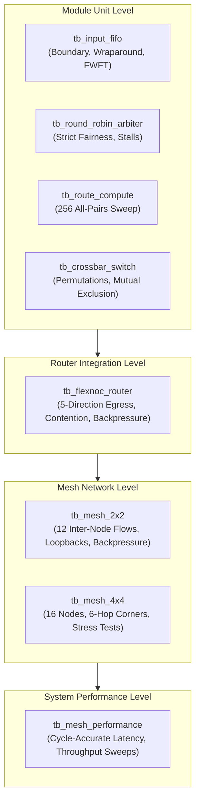

# FlexNoC Verification Plan

## 1. Overview & Strategy

The FlexNoC verification methodology is founded on a layered, bottom-up validation architecture that decouples functional correctness from network scaling. Verification is treated as a first-class engineering deliverable with independent, self-checking environments, formal simulation assertions, and reproducible pseudo-random workloads.

---

## 2. Testbench Scope & Hierarchy

| Testbench | Scope | Checking Mechanism | Pass Criteria |
| :--- | :--- | :--- | :--- |
| `tb_input_fifo.sv` | Synchronous FIFO buffer | Golden Queue Reference Model (`queue[$]`) | 100% data order match, correct flag states across 500 random operations |
| `tb_route_compute.sv` | Combinational XY Route | Algorithmic Expected Model | All 256 coordinates verified strictly one-hot, zero out-of-bounds error |
| `tb_round_robin_arbiter.sv` | Starvation-free Arbiter | Mathematical Fairness Accumulator | Strictly uniform grants (exact 20% share under persistent 5-way contention) |
| `tb_crossbar_switch.sv` | 5x5 Non-blocking Switch | Bit-accurate Multiplexer Verification | Correct data routing, zero cross-talk, ungranted ports output 0 |
| `tb_flexnoc_router.sv` | 5-Port Router Core | Directional and Contention Handshake Checks | Zero dropped flits under stalls, correct multi-input arbitration |
| `tb_mesh_2x2.sv` | 2x2 Network Mesh | Autonomous Receiver Scoreboards | All 12 directed pairs delivered, 100% accounting (Injected == Delivered) |
| `tb_mesh_4x4.sv` | 4x4 Scaled Network | Autonomous Per-Node Receiver Monitors | Corner-to-corner 6-hop traversal, diagonal routing, randomized traffic |
| `tb_mesh_performance.sv` | Traffic & Performance | Cycle-Accurate Latency Instrumentation | Empirical latency curves exported to JSON/CSV |

---

## 3. Protocol Handshake Invariants & Assertions

1. **Valid/Data Stability**:
   - Invariant: When `valid` is high and `ready` is low, `data` must not change on subsequent clock edges.
2. **Mutual Exclusion**:
   - Invariant: No output arbiter may grant more than one input port ($|\text{grant}| \le 1$).
   - Invariant: No input port may be granted to more than one output simultaneously.
3. **Buffer Integrity**:
   - Invariant: `fifo_count` never exceeds `DEPTH` and never underflows below 0.
4. **Conservation of Packets**:
   - Invariant: For any closed simulation run, $\text{Packets Injected} == \text{Packets Delivered} + \text{Packets in Buffers}$.

---

## 4. Failure Diagnostics

When any check fails:
- The exact cycle count, source node, destination node, packet ID, expected value, and observed value are logged to standard output.
- The simulator terminates immediately with a nonzero exit code (`$finish(1)`), halting regression orchestration.
